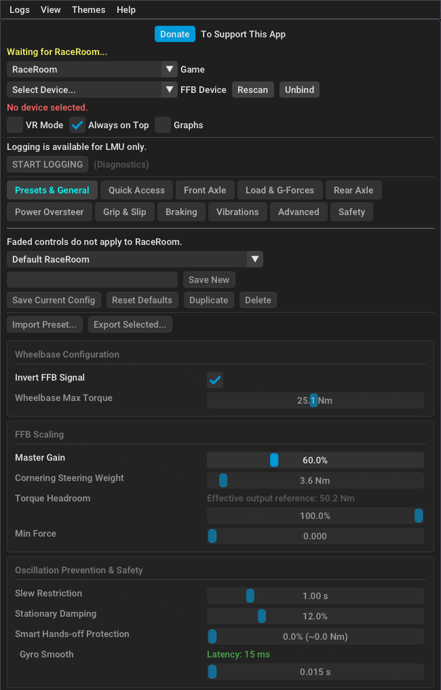

 [Donate to Support this App](https://ffbhub-shop.fourthwall.com)

# FFB-HUB (previously called LMUFFB)

A Telemetry-based Force Feedback app for LMU and RaceRoom.

LMUFFB is being renamed **FFB-HUB** as we expand support for additional racing simulators.

 **Support FFB-HUB:** [Make a donation](https://ffbhub-shop.fourthwall.com)

If you find this app useful, consider contributing to support ongoing development, bug fixes, and compatibility with more simulators (RaceRoom, Assetto Corsa EVO, and others).

Some of the advantages of this app (with the right settings and a direct drive wheelbase) are:

* Usually clearer FFB than with in-game FFB. Driving cues are easier to feel.
* You can still get some FFB improvements even in lower-end wheels (G29, T300), or DDs at 3-5 Nm
* Brake Feel and Understeer effects in RaceRoom
* Brake Feel effect in LMU
* For LMU, being able to catch power oversteer slides out of corners thanks to the Rotation Kick effects
* For LMU, more noticeable detail at comfortable (lower) force levels, while with the game FFB you usually have to make the FFB very strong in order to feel details that remain very subtle.
* FFB-HUB avoids having too strong FFB where it is not needed, and too weak when it is needed. The app gives a nicer, more balanced, more informative FFB experience.
* Some drivers describe the improvement in FFB that you can achieve with this app as much greater than the differences between direct drive wheelbases.
* Being able to customize the FFB to tailor it to your preferences. Reduce effects you find excessive and emphasize the information you find useful.

For example, in RaceRoom’s GT3 cars at Bathurst, in turn T3/T4 you can feel the load shifts as you go up and down on the track undulations, and you can tell if it is the front or the rear of the car that is washing out.

## 📥 Download

*   **[Standard Releases (Recommended)](https://github.com/coasting-nc/LMUFFB/releases)**: Stable versions, released less frequently.

## Installation & Configuration 

For both LMU and RaceRoom:

1. Extract the zip to a folder where you can write files, such as a folder in Documents or Downloads. Do not use Program Files.
2. Start FFBHUB.exe
3. Select your wheel under FFB Device.
4. Choose LMU or RaceRoom using the Game selector at the top of the app.
5. Run the game in Borderless Mode or VR (you can run the game before or after the app, it does not make any difference). 
6. In RaceRoom, turn off FFB.
7. In LMU, turn off "Use Constant Steering Force Effect" so the game does not tries to send its own FFB to the wheel at the same time. This should avoid FFB losses.
8. With the default **Shaft Torque** source, LMU's FFB Strength and other FFB settings do not change what you feel. LMU's settings (eg. strength, smoothing, minimum force, sensitivity) change what you feel if you choose Front Axle tab -> **In-Game FFB**; in this case, set LMU's FFB Strength to 100%, and adjust the strength in the app.
9. Set **Wheelbase Max Torque** to your wheel's real maximum torque, choose a profile (see "Choosing a profile" below) and adjust **Master Gain**.

When not in VR, make sure the game **Display Mode** is **Borderless** (prevents crashes and minimizing, and lets FFB-HUB's on-screen messages appear over the game).

### Where your settings are

- FFB-HUB keeps your settings and profiles in the **settings-v2** folder next to FFBHUB.exe (profiles in `settings-v2/user_presets`). The folder button next to the profile list opens it.
- When you update from an older version, your settings and profiles are converted once, and the original files are kept in `settings-v2/legacy-backup`.
- To use a profile someone shared, use **Import** (any folder works), or copy it into `settings-v2/user_presets`. A profile copied into the old `user_presets` folder is imported at the next start.
- To go back to an older version, run it from its own folder.

### Choosing a profile for LMU (FFB-HUB 0.8.40 and later)

| Profile | Effects | Balance |
| --- | --- | --- |
| **Pure Cornering (DD Default)** | • The most direct and raw • Strongest **Cornering Feel** and a firm **SoP Self-Aligning Torque** • The only default profile with **Center Feel** and **Direction Change Weight** • The earliest **Rotation Kick** and strongest **Power Kick** • Off: **Understeer Effect**, **Brake Feel**, **Smart Hands-off Protection** and all added vibrations (lock-up, ABS, slide) | What the car does in corners, with nothing added on top. |
| **Balanced Feel** | • The all-round profile • Medium **Cornering Feel** with **Cornering Feel Boost (Slide)** • The strongest **Brake Feel** • A clear **Understeer Effect** and a noticeable **Slide Rumble** • Moderate kicks, light smoothing, some **Kerb Calming** and light **Smart Hands-off Protection** • Off: lock-up and ABS vibrations | Every cue present at a moderate level, a little softer than Pure Cornering. |
| **Clean Steering + Lock-Up** | • The braking profile • The only one with **Lock-up Vibration** and **ABS Pulse** on • Strong **Cornering Feel** (slightly smoothed) • The strongest **SoP Self-Aligning Torque**, **Braking Kick** and **Cornering Weight** • Some **Brake Feel** and a clear **Understeer Effect** • Off: **Power Kick** • Slightly lower Steering Scale and Master Gain than the others | Steering-led, with clear feedback when you brake hard or lock a tyre. |
| **Clean Steering** | • Mostly the car's own steering force • Light **Cornering Feel**, **SoP Self-Aligning Torque**, **Understeer Effect** and **Brake Feel** • A small **Power Kick** • Off: **Braking Kick** and all added vibrations | Clean and steering-led, with few added effects. |
| **Minimalist Steering** | • The calmest • The weakest **Cornering Feel**, **SoP Self-Aligning Torque** and **Understeer Effect** • The strongest **Kerb Calming** and the most smoothing • A light **Slide Rumble** and light **Cornering Weight** • Off: **Brake Feel** • Vibrations a little quieter overall | Smooth and calm, with soft kerbs. |

Other profiles:
- T300 Default: Thrustmaster T300 and similar belt or gear wheels.

### Strength and vibration settings (LMU)

- **Car Steering Strength** (Front Axle tab): each car starts at a similar strength automatically. If one car feels too heavy or too light, adjust it here, also while driving or with a wheel button; FFB-HUB remembers it for that car on your computer. A higher value makes the steering lighter.
- **Minimum Vibration Strength** (General tab, Wheelbase Configuration): on weaker wheels, raise it if road, lock-up or other vibrations feel too faint. It belongs to your wheel, not to the profile.

### Button bindings

- In the **Button Bindings** tab you can bind wheel or controller buttons to Master Gain, other settings, profile switching and **Start / Stop Logging**.
- Bindings work whenever LMU is running (garage, pits, menus or on track), even when FFB-HUB is not the active window. Settings that can only change while parked show a message if you press them while moving.
- **Logging:** with one button bound, it starts and stops logging. Bind a second button if you want separate Start and Stop buttons.
- **On-screen messages** confirm each change. Starting a recording shows a red circle and "STARTED RECORDING"; stopping shows a grey square and "STOPPED RECORDING" with the saved file name. They appear over the game in borderless or windowed mode, not in exclusive fullscreen or VR. You can turn them off with "Show overlay confirmation" in the Button Bindings tab.

## Help us improve the app

1. **Report issues** - For bugs and technical issues, **it is much better to [open a GitHub issue](https://github.com/coasting-nc/LMUFFB/issues)** rather than posting on forums.
2. For LMU, post screenshots, thoughts and settings to the [LMU Forum Thread for the lmuFFB App](https://community.lemansultimate.com/index.php?threads/lmuffb-app.10440/)

### Recording a log to report a problem

Whenever you run into a problem or feel something on the wheel you dislike, recording a log right as it happens helps us see what occurred and fix it quickly.

1. **Bind a wheel button to Start / Stop Logging (recommended):**
   - Open the **Button Bindings** tab and find **Start / Stop Logging**.
   - **Click to assign** in the **Increase / Toggle / On** column and press a button on your wheel (`Esc` cancels).
   - With **one button** bound, it acts as a toggle: press it once while driving to start recording as soon as you feel the issue, and press it a second time to stop.
   - If you want separate buttons instead, bind a second button under **Decrease / Off**.

      

2. Overlay Confirmation Messages
   - Optional: The app shows overlay messages to confirm when it starts or stops recording a log.
   - To see these messages, tick the **Show overlay confirmation** option **Button Bindings**, and have the game in Borderless mode.

     

     

3. **Find the log and attach it to a GitHub issue:**
   - Logs are saved inside the **`logs`** folder next to `FFBHUB.exe`.
   - **Keep recordings short:** start recording just before the problem and stop soon after it. A log grows by about 10 MB per minute of driving.
   - If you change car or track while recording, the app starts a new log file, so a single recording can generate multiple logs files. But you can just zip the whole logs folder and share that for convenience
   - [Open a GitHub issue](https://github.com/coasting-nc/LMUFFB/issues), describe the problem and attach the `.log` files, or zip the whole **`logs`** folder and attach the zip.
   - GitHub limits single attachments to **25 MB** (about two minutes of driving). For a larger file, upload it to a file-sharing site (for example Google Drive, OneDrive or Dropbox) and post the link in the issue.
     
## Troubleshooting (LMU)

-   **The wheel oscillates on straights or jerks on corner exits**:
    -   Lower **Rotation Kick** (for example to 10-15%) and **SoP Self-Aligning Torque**.
    -   Lower **Direction Change Weight** if the first degrees of turn-in also feel heavy.
    -   Keep your hands on the wheel on fast straights; most wheels oscillate when released at speed.
-   **I am getting too much vibrations while braking**:
    -   Reduce the strength of **Lockup Vibration** (for example to 20%), or raise its **Start Slip** so it starts later and **Full Slip** so it reaches full strength later.
    -   Increase **Steering Smoothing** (Front Axle tab) to 8 ms.
    -   A shake when ABS works comes from the game's own steering force. Lower **In-Game FFB Gain**, or use LMU's own Smoothing setting (it adds a little delay).
-   **FFB-HUB says it could not set up its settings folder, or cannot save settings**:
    - This happens if the FFB-HUB folder is in a location without write permissions (for example inside `C:\Program Files`) or in a synchronised folder.
    - **Solution**: move the whole FFB-HUB folder to a normal folder, such as Documents or Downloads, and start it again.
-   **Inverted FFB (Force pushes away from center)**:
    -   If the FFB feels "backwards" or "inverted" while driving (wheel pushes away from center instead of pulling toward it), check the **"Invert FFB"** checkbox in the FFB-HUB app GUI.
    -   This reverses the force direction to match your wheel's expected behavior.
-   **No FFB**: 
    - Ensure the "FFB Device" in FFB-HUB app is your real wheel
    - Check if Connected to Le Mans Ultimate" appear in the GUI
    - Verify the FFB strength in your device driver is not too low
    - Increase Master Gain
    - Check the FFB-HUB app console for errors
-   **FFB too weak or too strong**:
    -   Adjust **Master Gain** (0% to 200%) or **Steering Scale**.
    -   If only one car feels too weak or too strong, adjust that car's **Car Steering Strength** (Front Axle tab, or a wheel button while driving).
-   **Violent oscillations or shaking**:
    -   Lower **Master Gain** a little, and check that **Wheelbase Max Torque** matches your wheel.
    -   Lower **Rotation Kick** and **SoP Self-Aligning Torque**.
-   **Strange pull in some scenarios**:
    -   If you feel a strange pull in specific driving situations, try reducing the **Rear Align Torque**.
- **Sharing profiles**:
    -   Share your FFB settings with the **Export** and **Import** buttons in the profile section.
    -   Exported profiles are small `.toml` files. They keep their balance on any wheel; the app tells you which wheel a profile was made on.
-   **The app has too many options and it's confusing**:
    -   A future version will include a **"Basic Mode"** with auto adjustment and defaults for most settings.
    -   We need to first determine which settings work best for most users and wheel types (Direct Drive vs Belt/Gear).
    -   **Please leave feedback** on the forum thread telling us what settings work best for you: [LMU Forum Thread](https://community.lemansultimate.com/index.php?threads/lmuffb-app.10440/)
-   **Any other issue**:
    -   **Preferred**: [Open a GitHub Issue](https://github.com/coasting-nc/LMUFFB/issues). This is the best way to ensure your issue is tracked and addressed. Our AI agents periodically scan and attempt to fix GitHub issues.
    -   Alternatively, post in the [LMU Forum Thread](https://community.lemansultimate.com/index.php?threads/lmuffb-app.10440/), but be aware that forum posts are harder to track.

## FAQ

**Q: Does the app constitute an unfair advantage ("cheating")?**

**A:** No. Multiple wheelbase manufacturers already provide or are implementing telemetry-based force feedback (including VNM, Simucube, and Simagic). By the same logic, those would constitute an "unfair advantage" too.

Additionally, bassshakers/transducers, active pedals, motion platforms, and other simracing equipment also give similar additional telemetry-based information (tire lockup, wheelspin, car behavior, etc.), and are not considered an unfair advantage either.

The app allows everybody to have the option of having additional telemetry-based feedback information, not just the owners of expensive equipment or particular wheelbases.

**Q: Does the app have an option to remove the feeling of flatspots vibrations from FFB? Is that an unfair advantage?**

**A:** No. The app used to have an option to soften one chosen vibration, like the similar option in Simucube's and other wheelbase software, so it was a legitimate feature. Despite its name ("Flatspot Suppression"), it did not target flat spots, and early testing showed it had no noticeable effect. It has been removed from the app.

**Q: Where does the app get its data from the game?**

**A:** From the official data interface that LMU provides for external apps, introduced with LMU 1.2 in December 2025.

## Upcoming Features

* Basic mode with only main sliders and auto adjustments of more advanced settings
* Wet Weather Haptics (Hydro-Grain): vibration cues telling when the tires are on dry or wet surface, and if there is grip or not. This tries to replicate some the particular wet track grip and dynamics that can be felt in real life cars.
* Support for other Sims (AC Evo, AC, ACC, rF2).
  
## Feedback & Support

For feedback, questions, or support:
*   **GitHub Issues (Recommended for Bugs)**: [Report bugs or request features](https://github.com/coasting-nc/LMUFFB/issues). GitHub issues are easier for us to track and are periodically tackled by AI development agents.
*   **LMU Forum Thread**: [lmuFFB App](https://community.lemansultimate.com/index.php?threads/lmuffb-app.10440/). Best for general discussion and sharing settings.

## Licensing & Project Status

As of April 11th 2026, this project has transitioned to a proprietary, closed-source model. 

### Statement on Independent Development and Licensing:
- **Ownership & Originality:** The current codebase is entirely proprietary and owned solely by the author. It has been developed independently from scratch.
- **No Third-Party GPL Code:** This software does not use, fork, incorporate, or depend on code from any other GPL-licensed projects. 
- **Transition from Open-Source:** Prior to April 11th 2026, an early prototype of this project was briefly hosted as open-source under the GPL license. 
- **Purging of Community Contributions:** To ensure complete compliance with open-source licenses, all of the previous minor contributions by external developers (including merged pull requests and community-suggested code snippets) have been entirely discarded and rewritten from scratch using clean-room, independent implementations. No community-contributed code remains in the current codebase.

We take intellectual property rights seriously and have taken exhaustive measures to ensure this software is entirely independent.

## Documentation

Note: these guides were written for older versions. Setting names and units have changed since; the sections above describe version 0.8.

*   [Step-by-step tuning guide](docs/user_guides/step_by_step_tuning_guide.md) - Build a profile from a clean start
*   [FFB troubleshooting guide](docs/user_guides/ffb_troubleshooting_guide.md) - What to change for what you feel
*   [FFB strength controls](docs/user_guides/FFB_Strength_UI_Guide.md) and the [Steering Scale guide](docs/user_guides/Cornering_Steering_Weight_Guide.md)
*   [Vibration pitch guide](docs/user_guides/frequency_tuning_guide.md)

##  Videos, Reviews and Tutorials

UKOG: [This FFB App is Blowing Up… But is it Actually Better? (Le Mans Ultimate)](https://www.youtube.com/watch?v=4OVys-06StM)

Gamer Muscle: [This FFB App Completely Transforms LMU – Full Setup, Profiles & Download](https://www.youtube.com/watch?v=CQJRmhMaoPU)

For the RaceRoom side of the app: Gamer Muscle: 
[RaceRoom FFB Just Got A HUGE Upgrade! You NEED This App! - FFB-HUB](https://www.youtube.com/watch?v=OprLKlyj4r8)

Dalking: [LMU FFB App Explained in Detail | Settings, Effects & My Setup](https://www.youtube.com/watch?v=qAvCqoPBkys)

[Dalking's video](https://www.youtube.com/watch?v=qAvCqoPBkys) is an excellent step by step guide for setting up the app from scratch for LMU, tuning each effect in the most effective order, and explaining what each effect does.

To find and share lmuFFB profiles, see:
* Dalking LMUFFB profile, developed for a 18 Nm VNM wheelbase, from his discord: https://discord.gg/xfwJwUa
* UKOG discord, which has a section with user profiles and discussions for specific wheelbases: https://discord.gg/ukog
* Gamer Muscle Patreon (free): from which you can download GM profiles for GT3s, LMP2, Hypercars, and a specific profile for lower Nm wheelbases (4 Nm): https://www.patreon.com/posts/lmuffb-app-gamer-155277185
